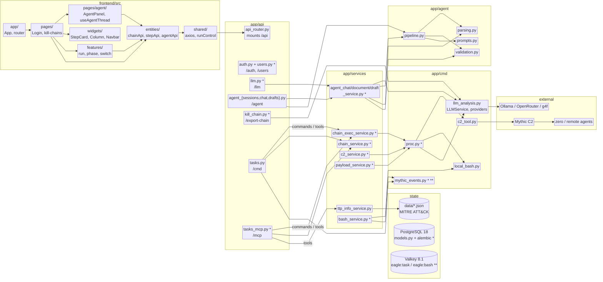
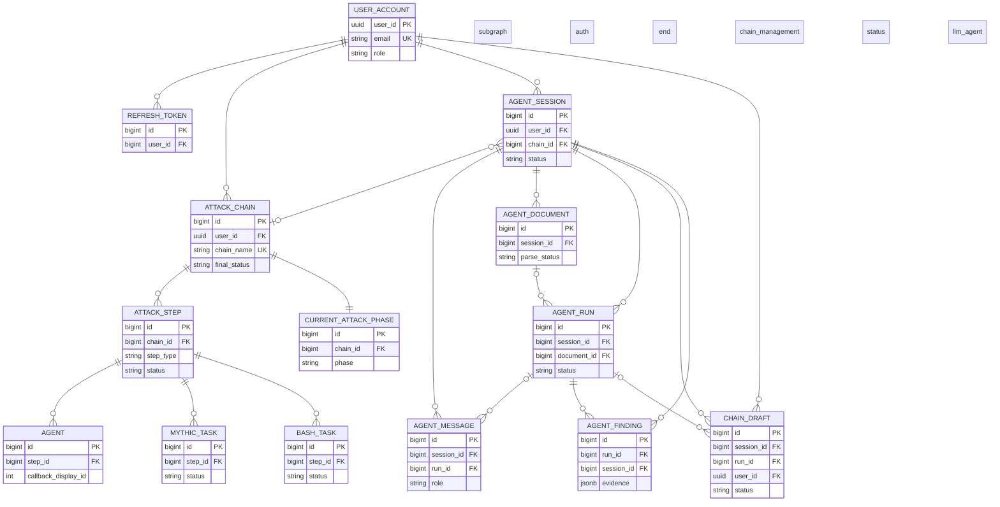

# EAGLE - Architecture

EAGLE is a FastAPI application with a small React frontend, PostgreSQL for the durable
record, Valkey for hot task state, and Mythic C2 as the execution backend. Operator input
and LLM suggestions become `AttackChain` rows, and those rows are replayed through Mythic
agents or local bash.

The runtime modules, how they connect, and the database model follow. Installation steps
are in the [README](../README.md).

## Technology overview

| Layer | Stack |
| --- | --- |
| Backend | Python 3.14, FastAPI 0.162, Pydantic 2, SQLAlchemy 2.1 async + asyncpg, Alembic |
| Data | PostgreSQL 18 (durable), Valkey 8.1 via `redis-py` (Redis protocol, hot events only) |
| Auth | PyJWT, bcrypt |
| C2 | Mythic 0.3.0rc9 client and GraphQL API |
| LLM | Ollama, OpenRouter / OpenAI-compatible endpoints, g4f pool |
| Agent / tooling | MCP 2.3 server, MITRE ATT&CK JSON loaded at startup |
| Frontend | React 19, Vite 8, React Router 7, Tailwind 4, assistant-ui, Phosphor icons |
| Runtime | Docker, uvicorn, uvloop |

## System architecture

Module paths are relative to `backend/` unless they start with `frontend/`. The diagram
shows runtime calls, not imports. A trailing `*` marks the modules that write
PostgreSQL; `**` marks the module that writes Valkey.

`frontend/src/app` owns routing; `pages/` holds login, the chain canvas, and the agent
panel; `entities/` holds the API clients; `features/` holds the run and phase hooks;
`widgets/` holds the canvas cards and navigation; `shared/` holds axios and run control.

`app/main.py` opens the Mythic connection and the event service at startup, hands the
finished `TTPInfoService` to `tasks_mcp`, and mounts `/api`, `/mcp`, and the built
frontend. `app/api/api_router.py` wires the endpoint files, which validate input and call
a service or the database session directly (`auth.py`, `users.py`, `kill_chain.py`).
Endpoints never import `app/cmd/*`; `app/services/*` owns chain, task, and agent
persistence, and all LLM access goes through `AgentChatService`
(`app/services/agent_chat_service.py`) on top of `app/cmd/llm_analysis.py`. That module
holds both the chain-work pool (`LLMService`) and the streaming agent providers
(`build_provider`, `list_models`).

Agent state is split across three services: `AgentChatService` (sessions, messages, runs,
LLM facade), `AgentDocumentService` (untrusted uploads and parsing), and
`AgentDraftService` (drafts, validation, chain import and edit operations). Shared
ownership checks live in `app/services/agent_scope.py`.

Chain execution goes through `app/cmd/proc.py`; Mythic tasking is in
`app/cmd/c2_tool.py`; local commands run in `app/cmd/local_bash.py`.
`app/cmd/mythic_events.py` is the only bridge that turns Mythic task events into Valkey
rows and NDJSON/SSE. `app/core/*` holds config, JWT/bcrypt, and the async database
session; the agent's safety caps (document size, chunking, temperature) live there as
module constants.

PostgreSQL is the durable record. Valkey holds current task status only, with a TTL. Raw
bash logs and parsed uploads stay in `backend/data/` and are referenced by path.

## Failure boundaries

- Mythic down at startup: EAGLE still starts, auth and database endpoints work, C2
  commands fail until the connection returns.
- Valkey down: the stream returns the initial database snapshot and then closes. The
  durable record is not affected.
- LLM down: suggestions and analysis fail, but stored chains still replay.
- Uploaded documents are untrusted data. They are parsed, never executed, and every
  finding must point to a verbatim span before validation accepts it.

## Database model

PostgreSQL is the durable store. Every model inherits `create_time` and `update_time` from
`Base`; only the important columns are shown below. The full schema is in
`backend/app/models.py`.

`CURRENT_ATTACK_PHASE` is one row per chain, `AGENT_FINDING` keeps `session_id` alongside
`run_id` for cheap session cleanup, and `CHAIN_DRAFT` stays JSONB until the operator
imports it into typed `ATTACK_STEP` rows.
